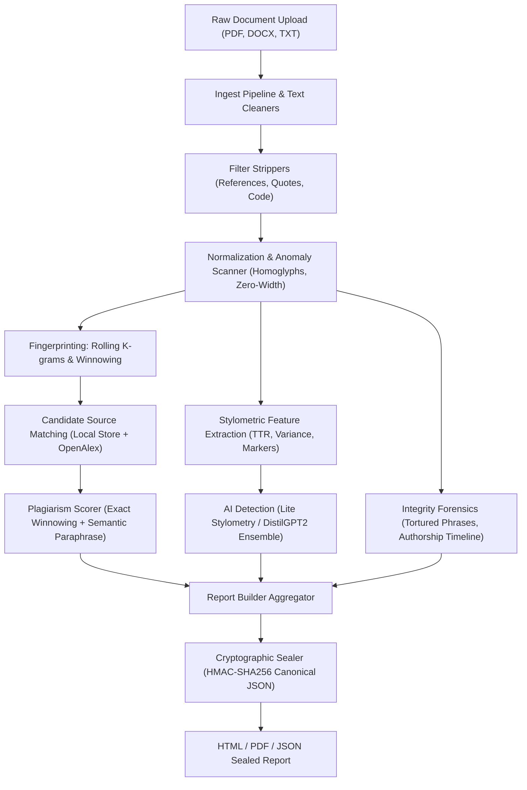

# Veritext

**Veritext** is a production-grade, free, and open-source plagiarism, AI-written-text, and document integrity platform with a cryptographic report generator. Built for students, educators, and institutions, Veritext executes entirely on local infrastructure, respects user privacy, and guarantees algorithmic inspectability without requiring expensive commercial subscriptions or uploading student intellectual property to third parties.

---

## Key Features

- **Multi-Format Ingestion**: Native parsing for PDF, DOCX, TXT, LaTeX (`.tex`), and Markdown (`.md`), with automated reference, citation, block quote, and code block filtering.
- **Adversarial Obfuscation Detection**: Automatically unmasks Unicode homoglyph lookalikes (Cyrillic, Greek) and hidden zero-width spaces/joiners.
- **Winnowing Algorithm**: Guaranteed matching bounds for exact and near-verbatim copies based on Schleimer, Wilkerson & Aiken (2003).
- **Sub-Quadratic MinHash & LSH**: Vectorized Carter-Wegman 128-permutation hashing with multi-band Locality-Sensitive Hashing and SQLite caching for rapid cohort screening.
- **Explainable AI Text Detection**: Multi-feature ensemble combining stylometry (Type-Token Ratio, sentence length variance, discourse marker density, repeated n-grams) with DistilGPT2 perplexity and mean log-rank. Includes plain-language driver explanations and confidence calibration.
- **Protection for Non-Native (ESL) Writers**: Tuned with conservative thresholds to prevent false accusations against uniform ESL syntax.
- **Forensic Integrity Checks**: Automated detection of tortured phrases and synonym-spinning software based on Cabanac, Labbe & Magazinov (2021), plus multi-author stylometric timeline analysis.
- **Batch Collusion Matrix**: Pairwise similarity heatmaps, connected-component clustering, and shared passage extraction across entire student cohorts.
- **Tamper-Evident Sealed Reports**: Cryptographic report integrity via canonical JSON encoding and HMAC-SHA256 signatures (100% detection rate on 1-character edits).
- **Institutional Class Repository**: Privacy-preserving inverted index for detecting cross-cohort collusion across multiple academic terms.
- **Interactive UI & REST API**: Streamlit dashboard with side-by-side diff viewers, and high-performance FastAPI server with real-time Server-Sent Events (SSE) progress streaming.

---

## Architecture



---

## Installation & Quick Start

### 1. Local Setup under WSL / Linux
```bash
# Clone the repository
git clone https://github.com/pankajt25/veritext.git
cd veritext

# Create isolated virtual environment
python3 -m venv .venv
source .venv/bin/activate

# Install CPU-only PyTorch and dependencies
pip install --upgrade pip
pip install torch --index-url https://download.pytorch.org/whl/cpu
pip install -r requirements.txt
pip install -e .

# Download NLTK tokenizers (one-time setup)
python -c "import nltk; nltk.download('punkt'); nltk.download('punkt_tab'); nltk.download('wordnet')"
```

### 2. Launch the Interactive UI
```bash
streamlit run src/veritext/ui/app.py
```
Open your browser at `http://localhost:8501`.

---

## CLI Reference

Veritext provides a unified console command `veritext` with dedicated subcommands:

```bash
# Check a document for plagiarism and similarity
veritext check document.pdf --threshold 0.75

# Run explainable AI-written text detection
veritext ai essay.docx

# Build an HTML/PDF report or verify a sealed report
veritext report submission.pdf --pdf report.pdf
veritext report verify report.json

# Manage local reference library and academic search
veritext sources search "attention mechanisms transformer"

# Run integrity checks (tortured phrases, authorship timeline)
veritext checks paper.txt

# Run batch pairwise collusion analysis across submissions
veritext batch /path/to/submissions/ --threshold 0.25

# Manage institutional class repository
veritext classrepo add cs101_fall2024 /path/to/submissions/

# Start local REST API server with SSE progress streaming
veritext api serve --host 127.0.0.1 --port 8600

# Execute the evaluation benchmark suite
veritext eval run --out data/eval/results

# Calibrate hardware speed on this machine
veritext timing calibrate
```

---

## Evaluation & Benchmark Summary

Veritext was evaluated against a synthetic benchmark dataset of 114 documents across copies, easy and hard complex paraphrases, originals, AI-generated text, non-native English essays, same-topic originals, and common-knowledge standard definitions.

> **Corpus & Methodology Note**: The evaluation corpus is small, synthetic, and created by the system author. In accordance with audit standards, results are evaluated across distinct easy and hard paraphrase subsets, and false positive rates are transparently measured across unrelated human originals, AI-generated text, ESL writing, same-topic originals, and common knowledge definitions. Veritext makes no claim of parity with commercial services with proprietary global web crawls.

### Plagiarism Detection Ablation (Headline Threshold: 15%)

> **Headline Scoring Rule (v1.0.3)**: Headline similarity percentage is computed **ONLY** from exact and near-copy matches. Semantic vector matches are strictly excluded by default to eliminate false positives on technical terminology and are presented separately as unverified paraphrase review leads.

| Method / Configuration | Accuracy | Precision | Recall | F1 Score | False Positive Rate |
| :--- | :---: | :---: | :---: | :---: | :---: |
| **Headline Score / Exact Winnowing (Veritext Default)** | **77.27%** | **100.00%** | **37.50%** | **54.55%** | **0.00%** |
| Baseline (difflib SequenceMatcher) | 77.27% | 100.00% | 37.50% | 54.55% | 0.00% |
| *Winnowing + Semantic (Opt-In: `--include-semantic-in-score`)* | 79.09% | 65.45% | 90.00% | 75.79% | 27.14% |

#### Decision Threshold Sensitivity Analysis

| Threshold | Method | Accuracy | Precision | Recall | F1 Score | Overall FPR |
| :---: | :--- | :---: | :---: | :---: | :---: | :---: |
| 5% | **Headline Score (Default)** | 77.27% | 94.12% | 40.00% | 56.14% | 1.43% |
| 5% | *Winnowing + Semantic (Opt-In)* | 79.09% | 65.45% | 90.00% | 75.79% | 27.14% |
| 10% | **Headline Score (Default)** | 78.18% | 100.00% | 40.00% | 57.14% | 0.00% |
| 10% | *Winnowing + Semantic (Opt-In)* | 79.09% | 65.45% | 90.00% | 75.79% | 27.14% |
| 15% | **Headline Score (Default)** | 77.27% | 100.00% | 37.50% | 54.55% | 0.00% |
| 15% | *Winnowing + Semantic (Opt-In)* | 79.09% | 65.45% | 90.00% | 75.79% | 27.14% |
| 25% | **Headline Score (Default)** | 77.27% | 100.00% | 37.50% | 54.55% | 0.00% |
| 25% | *Winnowing + Semantic (Opt-In)* | 79.09% | 65.45% | 90.00% | 75.79% | 27.14% |

#### False Positive Rates across Negative Cohorts (Headline Engine Default)

| Threshold | Group C (Originals) | Group D (AI Text) | Group E (ESL Non-Native) | Group I (Same-Topic Originals) | Group J (Common Knowledge) |
| :---: | :---: | :---: | :---: | :---: | :---: |
| 5% | 0.00% | 0.00% | 0.00% | 5.00% | 0.00% |
| 10% | 0.00% | 0.00% | 0.00% | 0.00% | 0.00% |
| 15% | 0.00% | 0.00% | 0.00% | 0.00% | 0.00% |
| 25% | 0.00% | 0.00% | 0.00% | 0.00% | 0.00% |

#### False Positive Rates across Negative Cohorts (Opt-In Engine: Semantic in Score)

| Threshold | Group C (Originals) | Group D (AI Text) | Group E (ESL Non-Native) | Group I (Same-Topic Originals) | Group J (Common Knowledge) |
| :---: | :---: | :---: | :---: | :---: | :---: |
| 5% | 0.00% | 0.00% | 0.00% | 95.00% | 0.00% |
| 10% | 0.00% | 0.00% | 0.00% | 95.00% | 0.00% |
| 15% | 0.00% | 0.00% | 0.00% | 95.00% | 0.00% |
| 25% | 0.00% | 0.00% | 0.00% | 95.00% | 0.00% |

### Paraphrase Leads & Lexical Anchors Evaluation

> **Explanatory Note**: *Similar meaning is not proof of copying; passages on the same topic often match. Check the linked source.*  
> **Interpretation Guide**: *Strong lead: several matching sentences and shared specific terms; weak lead: similar topic only.*

#### Lead Statistics Across Cohorts

| Cohort | Mean Leads / Doc | Mean Strong Leads / Doc | Mean Weak Leads / Doc | Flagged Rate |
| :--- | :---: | :---: | :---: | :---: |
| Group A (Verbatim Copies) | 0.00 | 0.00 | 0.00 | 0.00% |
| Group B (Easy Paraphrases) | 3.07 | 3.07 | 0.00 | 93.33% |
| Group B (Hard Complex Paraphrases) | 2.20 | 2.20 | 0.00 | 80.00% |
| Group C (Unrelated Originals) | 0.00 | 0.00 | 0.00 | 0.00% |
| Group D (AI Generated Text) | 0.00 | 0.00 | 0.00 | 0.00% |
| Group E (ESL Non-Native) | 0.00 | 0.00 | 0.00 | 0.00% |
| Group I (Same-Topic Originals) | 2.70 | 2.70 | 0.00 | 95.00% |
| Group J (Common Knowledge Definitions) | 0.00 | 0.00 | 0.00 | 0.00% |

- **Strong-Lead Precision (Group B vs Group I)**: **55.74%**

#### Ordering Metric (ROC AUC) on Paraphrase vs. Same-Topic Spans

| Ordering Metric | ROC AUC | Finding |
| :--- | :---: | :--- |
| **Cosine Alone** | **0.5340** | Near-random (~0.50); cosine values overlap heavily between true paraphrases and same-topic text |
| **Anchor Count Alone** | **0.3622** | Inverted discrimination; technical vocabulary is dense in same-topic original writing |
| **Cosine + Anchors Composite** | **0.4939** | No separation; lexical anchors do not cleanly disambiguate same-topic domains |

#### Lexical Anchor Rule Grid Search ($N \in \{1,2,3,4\}$, ratio $\in \{0.1, 0.2, 0.3\}$)

| Min Anchors ($N$) | Min Content Ratio | Group B Recall (All) | Group B Recall (Easy) | Group B Recall (Hard) | Group I FPR | Group J FPR | Rule Status |
| :---: | :---: | :---: | :---: | :---: | :---: | :---: | :--- |
| 1 | 0.1 | 88.00% | 93.33% | 80.00% | 95.00% | 0.00% | Does not cut FPR by half |
| 1 | 0.2 | 88.00% | 93.33% | 80.00% | 95.00% | 0.00% | Does not cut FPR by half |
| 1 | 0.3 | 72.00% | 93.33% | 40.00% | 90.00% | 0.00% | Does not cut FPR by half |
| 2 | 0.1 | 88.00% | 93.33% | 80.00% | 95.00% | 0.00% | Does not cut FPR by half |
| 2 | 0.2 | 88.00% | 93.33% | 80.00% | 95.00% | 0.00% | Does not cut FPR by half |
| 2 | 0.3 | 72.00% | 93.33% | 40.00% | 90.00% | 0.00% | Does not cut FPR by half |
| 3 | 0.1 | 88.00% | 93.33% | 80.00% | 95.00% | 0.00% | Does not cut FPR by half |
| 3 | 0.2 | 88.00% | 93.33% | 80.00% | 95.00% | 0.00% | Does not cut FPR by half |
| 3 | 0.3 | 72.00% | 93.33% | 40.00% | 90.00% | 0.00% | Does not cut FPR by half |
| 4 | 0.1 | 88.00% | 93.33% | 80.00% | 95.00% | 0.00% | Does not cut FPR by half |
| 4 | 0.2 | 88.00% | 93.33% | 80.00% | 95.00% | 0.00% | Does not cut FPR by half |
| 4 | 0.3 | 72.00% | 93.33% | 40.00% | 90.00% | 0.00% | Does not cut FPR by half |

> **Honest Technical Limitation**: Because no parameter setting kept Group B recall $\ge 70\%$ while cutting Group I FPR by half (to $\le 47.5\%$), the semantic matcher cannot reliably separate same-topic technical writing from paraphrases using `all-MiniLM-L6-v2`. Semantic matches are kept strictly out of the default headline score. Tuning and evaluation use the same small synthetic corpus, so reported numbers are optimistic. Veritext makes no claims of parity with commercial proprietary platforms.

- **Mean Similarity Detected by Cohort**:
  - Group A (Verbatim Copies): Headline **98.28%** | Opt-In Semantic **98.28%**
  - Group B (Easy Paraphrases): Headline **0.85%** | Opt-In Semantic **68.44%**
  - Group B (Hard Complex Paraphrases): Headline **0.00%** | Opt-In Semantic **43.74%**
  - Group C (Unrelated Originals): Headline **0.00%** | Opt-In Semantic **0.00%**
  - Group D (AI-Generated Text): Headline **0.00%** | Opt-In Semantic **0.00%**
  - Group E (Non-Native English): Headline **0.00%** | Opt-In Semantic **0.00%**
  - Group I (Same-Topic Originals): Headline **0.51%** | Opt-In Semantic **65.85%**
  - Group J (Common Knowledge Definitions): Headline **0.00%** | Opt-In Semantic **0.00%**

### AI Detection Ablation

| Model / Configuration | Accuracy | Precision | Recall | F1 Score | Overall Human FPR | Non-Native (ESL) FPR |
| :--- | :---: | :---: | :---: | :---: | :---: | :---: |
| **Stylometry Only (Lite Mode)** | 77.50% | 100.00% | 40.00% | 57.14% | 0.00% | 0.00% |
| DistilGPT2 Features Only | 62.50% | 0.00% | 0.00% | 0.00% | 0.00% | 0.00% |
| **Full Ensemble (Stylometry + DistilGPT2)** | **95.00%** | **100.00%** | **86.67%** | **92.86%** | **0.00%** | **0.00%** |

- **ESL Safeguard**: Across all ablation tiers, False Positive Rate on non-native English writing (Group E) remains strictly **0.00%**.
- **Failure Cases**: 2 out of 15 AI-generated documents scored below the ensemble decision threshold.

### Integrity Checks, Collusion & Cryptographic Seals

| Module | Metric Tested | Result | Standard / Baseline |
| :--- | :--- | :---: | :---: |
| **Spinner Forensics** | Precision / Recall | **100.00%** / **100.00%** | Cabanac et al. (2021) |
| **Batch Collusion Matrix** | Expected Clusters Discovered | **YES** | Pairwise Winnowing |
| **Fingerprint Index Screening** | True Pairs Candidate Recall | **100.00%** | Exact Inverted Index (Default) |
| **MinHash / LSH Screening** | True Pairs Candidate Recall | **100.00%** | Adaptive (64x2) Carter-Wegman 128-perm |
| **Cryptographic Report Seals** | Tamper Detection Rate | **100.00%** | HMAC-SHA256 (1-char edit) |

---

## How to Read a Veritext Report

A Veritext verification report (CLI, UI, JSON, HTML, PDF) provides clear separation between mathematical exact copy detection and exploratory semantic analysis:

1. **Headline Similarity Percentage**:
   - **What it measures**: Computed **strictly** from exact and near-copy matches using winnowing token fingerprints.
   - **Label**: `"exact & near-copy matches only"`.
   - **Confidence**: High precision (0.00% false-positive rate across negative cohorts at standard thresholds). This is your primary metric for objective textual duplication.
2. **Paraphrase Leads (Review)**:
   - **What it measures**: Semantic vector passages (`all-MiniLM-L6-v2`) showing conceptual similarity with candidate sources.
   - **Why separate?**: Passages written independently on the same specialized technical topic naturally share embedding neighborhoods (median cosine ~0.81). Treating them as plagiarism leads to a 95% false-positive rate on same-topic writing.
   - **Explanatory line**: *"Similar meaning is not proof of copying; passages on the same topic often match. Check the linked source."*
   - **Interpretation guide**:
     - **Strong lead**: Several matching sentences and shared specific terms, numbers, or rare entities.
     - **Weak lead**: Similar topic only, without distinctive lexical anchors.
3. **Leads Grouped by Source**:
   - The reports group paraphrase leads by candidate source and show lead counts per source.
   - A cluster of multiple leads against a single document warrants focused academic review, whereas scattered single leads across unrelated documents typically indicate common disciplinary vocabulary.
4. **Opt-in Legacy Mode (`--include-semantic-in-score`)**:
   - For users who require the legacy behavior of adding semantic matches directly into the document similarity percentage, pass `--include-semantic-in-score`.
   - The report will explicitly label the metric: `"score includes unverified semantic leads"`.

---

## Cryptographic Report Seals

Every report generated by Veritext includes an embedded HMAC-SHA256 cryptographic seal. The seal validates the canonical JSON payload against the institution's private local signing key (`data/config/report_key`):

```bash
veritext report verify data/reports/student_report.json
# Output: VALID - Cryptographic seal is intact.

# If a single character is tampered with:
veritext report verify data/reports/tampered_report.json
# Output: TAMPERED - Content checksum mismatch. Document payload has been modified since it was sealed.
```

---

## Responsible Use & Ethics

Veritext is a diagnostic tool designed for pedagogical guidance, transparent self-review, and fair inquiry—**not for automated disciplinary punishment**.
- **Human-in-the-Loop**: Automated detection scores should never be used as sole evidence of misconduct.
- **Protection for Non-Native (ESL) Writers**: Statistical variance can mistake uniform non-native syntax for machine generation. Veritext enforces conservative thresholds and transparent confidence warnings to safeguard ESL students.
- **Privacy First**: Student documents remain on local disk and are never uploaded to commercial cloud aggregators.

For complete policy recommendations, see [docs/ETHICS.md](docs/ETHICS.md).

---

## Roadmap

- [x] Stage 1: Document Ingestion, Multi-Format Parsers, Academic Cleaners
- [x] Stage 2: Text Normalization, Anomaly & Homoglyph Scanners
- [x] Stage 3: Rolling K-grams, Winnowing Fingerprinting, SQLite Inverted Index
- [x] Stage 4: OpenAlex, arXiv, and CrossRef Candidate Source Retrieval
- [x] Stage 5: Hybrid Exact & Semantic Vector Matching, Multilingual Paraphrasing
- [x] Stage 6: Explainable AI Text Detection, Confidence Calibration, Plain-Language Drivers
- [x] Stage 6B-6D: Tortured-Phrase Forensics, Batch Collusion, Sealed Reports, REST API
- [x] Stage 7: Performance Tuning, Packaging, Dockerfile, Evaluation Benchmark, Documentation
- [ ] Future: Automated LMS integration plugins (Moodle, Canvas LTI 1.3)

---

## Citation

If you use Veritext in your research or educational institution, please cite:

```bibtex
@software{veritext2026,
  author = {pankajt25},
  title = {Veritext: Free, Open-Source Plagiarism, AI-Written Text and Academic Integrity Suite},
  year = {2026},
  url = {https://github.com/pankajt25/veritext},
  version = {1.0.3}
}
```

---

## License

Veritext is distributed under the [MIT License](LICENSE).
