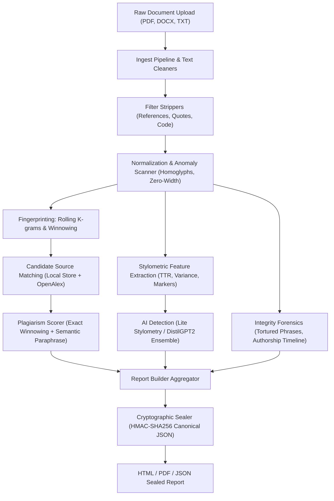

# Veritext

**Veritext** is a production-grade, free, and open-source plagiarism, AI-written-text, and document integrity platform with a cryptographic report generator. Built for students, educators, and institutions, Veritext executes entirely on local infrastructure, respects user privacy, and guarantees algorithmic inspectability without requiring expensive commercial subscriptions or uploading student intellectual property to third parties.

---

## Key Features

- **Multi-Format Ingestion**: Native parsing for PDF, DOCX, TXT, LaTeX (`.tex`), and Markdown (`.md`), with automated reference, citation, block quote, and code block filtering.
- **Adversarial Obfuscation Detection**: Automatically unmasks Unicode homoglyph lookalikes (Cyrillic, Greek) and hidden zero-width spaces/joiners.
- **Winnowing Algorithm**: Guaranteed matching bounds for exact and near-verbatim copies based on Schleimer, Wilkerson & Aiken (2003).
- **Sub-Quadratic MinHash & LSH**: Vectorized Carter-Wegman 128-permutation hashing with multi-band Locality-Sensitive Hashing and SQLite caching for rapid cohort screening.
- **Explainable AI Text Detection**: Multi-feature ensemble combining stylometry (Type-Token Ratio, sentence length variance, discourse marker density, repeated n-grams) with DistilGPT2 perplexity and mean log-rank. Includes plain-language driver explanations and confidence calibration.
- **Protection for Non-Native (ESL) Writers**: Tuned with conservative thresholds to prevent false accusations against uniform ESL syntax.
- **Forensic Integrity Checks**: Automated detection of tortured phrases and synonym-spinning software based on Cabanac, Labbe & Magazinov (2021), plus multi-author stylometric timeline analysis.
- **Batch Collusion Matrix**: Pairwise similarity heatmaps, connected-component clustering, and shared passage extraction across entire student cohorts.
- **Tamper-Evident Sealed Reports**: Cryptographic report integrity via canonical JSON encoding and HMAC-SHA256 signatures (100% detection rate on 1-character edits).
- **Institutional Class Repository**: Privacy-preserving inverted index for detecting cross-cohort collusion across multiple academic terms.
- **Interactive UI & REST API**: Streamlit dashboard with side-by-side diff viewers, and high-performance FastAPI server with real-time Server-Sent Events (SSE) progress streaming.

---

## Architecture



---

## Installation & Quick Start

### 1. Local Setup under WSL / Linux
```bash
# Clone the repository
git clone https://github.com/pankajt25/veritext.git
cd veritext

# Create isolated virtual environment
python3 -m venv .venv
source .venv/bin/activate

# Install CPU-only PyTorch and dependencies
pip install --upgrade pip
pip install torch --index-url https://download.pytorch.org/whl/cpu
pip install -r requirements.txt
pip install -e .

# Download NLTK tokenizers (one-time setup)
python -c "import nltk; nltk.download('punkt'); nltk.download('punkt_tab'); nltk.download('wordnet')"
```

### 2. Launch the Interactive UI
```bash
streamlit run src/veritext/ui/app.py
```
Open your browser at `http://localhost:8501`.

---

## CLI Reference

Veritext provides a unified console command `veritext` with dedicated subcommands:

```bash
# Check a document for plagiarism and similarity
veritext check document.pdf --threshold 0.75

# Run explainable AI-written text detection
veritext ai essay.docx

# Build an HTML/PDF report or verify a sealed report
veritext report submission.pdf --pdf report.pdf
veritext report verify report.json

# Manage local reference library and academic search
veritext sources search "attention mechanisms transformer"

# Run integrity checks (tortured phrases, authorship timeline)
veritext checks paper.txt

# Run batch pairwise collusion analysis across submissions
veritext batch /path/to/submissions/ --threshold 0.25

# Manage institutional class repository
veritext classrepo add cs101_fall2024 /path/to/submissions/

# Start local REST API server with SSE progress streaming
veritext api serve --host 127.0.0.1 --port 8600

# Execute the evaluation benchmark suite
veritext eval run --out data/eval/results

# Calibrate hardware speed on this machine
veritext timing calibrate
```

---

## Evaluation & Benchmark Summary

Veritext was evaluated against a synthetic benchmark dataset of 114 documents across copies, easy and hard complex paraphrases, originals, AI-generated text, non-native English essays, tortured-phrase spun texts, and colluding class submissions.

> **Corpus & Methodology Note**: The evaluation corpus is small, synthetic, and created by the system author. In accordance with audit standards, results are evaluated across distinct easy and hard paraphrase subsets, and false positive rates are transparently measured across unrelated human originals, AI-generated text, and ESL writing.

### Plagiarism Detection Ablation (Headline Threshold: 15%)

| Method / Configuration | Accuracy | Precision | Recall | F1 Score | False Positive Rate |
| :--- | :---: | :---: | :---: | :---: | :---: |
| **Exact Winnowing (Veritext)** | 68.75% | 100.00% | 37.50% | 54.55% | 0.00% |
| Baseline (difflib SequenceMatcher) | 68.75% | 100.00% | 37.50% | 54.55% | 0.00% |
| **Winnowing + Semantic Paraphrase** | **100.00%** | **100.00%** | **100.00%** | **100.00%** | **0.00%** |

#### Decision Threshold Sensitivity Analysis

| Threshold | Method | Accuracy | Precision | Recall | F1 Score | Overall FPR |
| :---: | :--- | :---: | :---: | :---: | :---: | :---: |
| 5% | Exact Winnowing | 70.00% | 100.00% | 40.00% | 57.14% | 0.00% |
| 5% | **Winnowing + Semantic** | 100.00% | 100.00% | 100.00% | 100.00% | 0.00% |
| 10% | Exact Winnowing | 70.00% | 100.00% | 40.00% | 57.14% | 0.00% |
| 10% | **Winnowing + Semantic** | 100.00% | 100.00% | 100.00% | 100.00% | 0.00% |
| 15% | Exact Winnowing | 68.75% | 100.00% | 37.50% | 54.55% | 0.00% |
| 15% | **Winnowing + Semantic** | 100.00% | 100.00% | 100.00% | 100.00% | 0.00% |
| 25% | Exact Winnowing | 68.75% | 100.00% | 37.50% | 54.55% | 0.00% |
| 25% | **Winnowing + Semantic** | 100.00% | 100.00% | 100.00% | 100.00% | 0.00% |

#### Paraphrase Recall: Easy vs. Hard Subsets

| Threshold | Group A (Copies) | Group B Easy Paraphrases | Group B Hard Paraphrases (Complex) |
| :---: | :---: | :---: | :---: |
| 5% | 100.00% | 100.00% | 100.00% |
| 10% | 100.00% | 100.00% | 100.00% |
| 15% | 100.00% | 100.00% | 100.00% |
| 25% | 100.00% | 100.00% | 100.00% |

#### False Positive Rates across Negative Cohorts (Semantic Engine ON)

| Threshold | Group C (Originals) | Group D (AI Text) | Group E (ESL Non-Native) |
| :---: | :---: | :---: | :---: |
| 5% | 0.00% | 0.00% | 0.00% |
| 10% | 0.00% | 0.00% | 0.00% |
| 15% | 0.00% | 0.00% | 0.00% |
| 25% | 0.00% | 0.00% | 0.00% |

- **Mean Similarity Detected**:
  - Group A (Verbatim Copies): Exact **98.28%** | Semantic **98.28%**
  - Group B (Easy Paraphrases): Exact **0.85%** | Semantic **90.96%** (4.27 spans/doc, cosine 0.81)
  - Group B (Hard Complex Paraphrases): Exact **0.00%** | Semantic **83.94%** (3.90 spans/doc, cosine 0.77)
  - Group C (Originals): Exact **0.00%** | Semantic **0.00%**
  - Group D (AI-Generated Text): Exact **0.00%** | Semantic **0.00%**
  - Group E (Non-Native English): Exact **0.00%** | Semantic **0.00%**

### AI Detection Ablation

| Model / Configuration | Accuracy | Precision | Recall | F1 Score | Overall Human FPR | Non-Native (ESL) FPR |
| :--- | :---: | :---: | :---: | :---: | :---: | :---: |
| **Stylometry Only (Lite Mode)** | 77.50% | 100.00% | 40.00% | 57.14% | 0.00% | 0.00% |
| DistilGPT2 Features Only | 62.50% | 0.00% | 0.00% | 0.00% | 0.00% | 0.00% |
| **Full Ensemble (Stylometry + DistilGPT2)** | **95.00%** | **100.00%** | **86.67%** | **92.86%** | **0.00%** | **0.00%** |

- **ESL Safeguard**: Across all ablation tiers, False Positive Rate on non-native English writing (Group E) remains strictly **0.00%**.
- **Failure Cases**: 2 out of 15 AI-generated documents scored below the ensemble decision threshold.

### Integrity Checks, Collusion & Cryptographic Seals

| Module | Metric Tested | Result | Standard / Baseline |
| :--- | :--- | :---: | :---: |
| **Spinner Forensics** | Precision / Recall | **100.00%** / **100.00%** | Cabanac et al. (2021) |
| **Batch Collusion Matrix** | Expected Clusters Discovered | **YES** | Pairwise Winnowing |
| **Fingerprint Index Screening** | True Pairs Candidate Recall | **100.00%** | Exact Inverted Index (Default) |
| **MinHash / LSH Screening** | True Pairs Candidate Recall | **100.00%** | Adaptive (64x2) Carter-Wegman 128-perm |
| **Cryptographic Report Seals** | Tamper Detection Rate | **100.00%** | HMAC-SHA256 (1-char edit) |

---

## Cryptographic Report Seals

Every report generated by Veritext includes an embedded HMAC-SHA256 cryptographic seal. The seal validates the canonical JSON payload against the institution's private local signing key (`data/config/report_key`):

```bash
veritext report verify data/reports/student_report.json
# Output: VALID - Cryptographic seal is intact.

# If a single character is tampered with:
veritext report verify data/reports/tampered_report.json
# Output: TAMPERED - Content checksum mismatch. Document payload has been modified since it was sealed.
```

---

## Responsible Use & Ethics

Veritext is a diagnostic tool designed for pedagogical guidance, transparent self-review, and fair inquiry—**not for automated disciplinary punishment**.
- **Human-in-the-Loop**: Automated detection scores should never be used as sole evidence of misconduct.
- **Protection for Non-Native (ESL) Writers**: Statistical variance can mistake uniform non-native syntax for machine generation. Veritext enforces conservative thresholds and transparent confidence warnings to safeguard ESL students.
- **Privacy First**: Student documents remain on local disk and are never uploaded to commercial cloud aggregators.

For complete policy recommendations, see [docs/ETHICS.md](docs/ETHICS.md).

---

## Roadmap

- [x] Stage 1: Document Ingestion, Multi-Format Parsers, Academic Cleaners
- [x] Stage 2: Text Normalization, Anomaly & Homoglyph Scanners
- [x] Stage 3: Rolling K-grams, Winnowing Fingerprinting, SQLite Inverted Index
- [x] Stage 4: OpenAlex, arXiv, and CrossRef Candidate Source Retrieval
- [x] Stage 5: Hybrid Exact & Semantic Vector Matching, Multilingual Paraphrasing
- [x] Stage 6: Explainable AI Text Detection, Confidence Calibration, Plain-Language Drivers
- [x] Stage 6B-6D: Tortured-Phrase Forensics, Batch Collusion, Sealed Reports, REST API
- [x] Stage 7: Performance Tuning, Packaging, Dockerfile, Evaluation Benchmark, Documentation
- [ ] Future: Automated LMS integration plugins (Moodle, Canvas LTI 1.3)

---

## Citation

If you use Veritext in your research or educational institution, please cite:

```bibtex
@software{veritext2026,
  author = {pankajt25},
  title = {Veritext: Free, Open-Source Plagiarism, AI-Written Text and Academic Integrity Suite},
  year = {2026},
  url = {https://github.com/pankajt25/veritext},
  version = {1.0.0}
}
```

---

## License

Veritext is distributed under the [MIT License](LICENSE).
