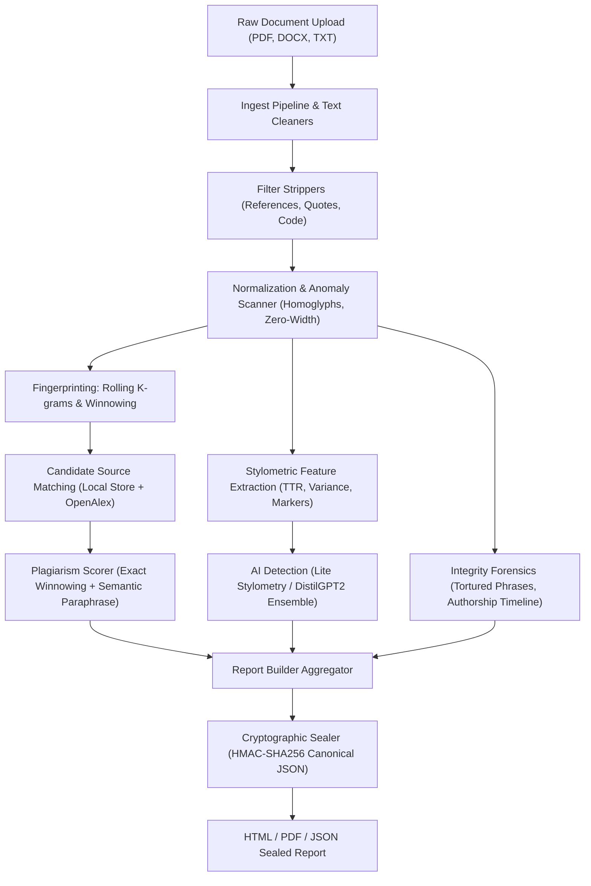

# Veritext Architecture & Technical Specification

## 1. System Overview
**Veritext** is a modular, open-source academic integrity platform combining text normalization, winnowing fingerprinting, locality-sensitive hashing (LSH), stylometric and language-model AI detection, structural integrity checks, cryptographic report sealing, and an interactive review dashboard.

---

## 2. Package & Module Map

```
src/veritext/
├── __init__.py           # Package version and top-level exports
├── __main__.py           # CLI router (python -m veritext)
├── cli.py                # Console script entry point ('veritext' subcommands)
├── profile.py            # Hardware & document profiling (word count, reading time)
├── planner.py            # Execution planner (memory budgeting, section sampling)
├── timing.py             # Machine execution speed calibration & persistence
│
├── ingest/               # Document ingestion & format parsing
│   ├── loaders.py        # PDF, DOCX, TXT, LaTeX, Markdown loaders
│   ├── splitter.py       # NLTK sentence and paragraph segmenters
│   ├── filters.py        # Reference, quote, code block, and math strippers
│   └── pipeline.py       # High-level document loading pipeline
│
├── normalize/            # Text canonicalisation & anomaly detection
│   ├── homoglyphs.py     # Unicode homoglyphic character mapping
│   ├── zerowidth.py      # Hidden zero-width space/joiner detection
│   └── normalize.py      # Case-folding, whitespace normalization, tokenization
│
├── fingerprint/          # Hashing and indexing engines
│   ├── kgrams.py         # Rolling k-gram generation (default k=5)
│   ├── winnow.py         # Winnowing algorithm with sliding window (w=4)
│   ├── minhash.py        # 128-permutation Carter-Wegman vectorised MinHash & LSH
│   └── index.py          # SQLite inverted index for fingerprint lookups
│
├── sources/              # Reference source retrieval & management
│   ├── store.py          # Local reference document library in SQLite
│   ├── query_builder.py  # TF-IDF query generation for academic APIs
│   ├── retrieval.py      # OpenAlex, arXiv, and CrossRef candidate search
│   └── fulltext.py       # Open-access PDF/HTML full-text retriever
│
├── similarity/           # Plagiarism scoring & match span discovery
│   ├── exact.py          # Winnowing match clustering & span chaining
│   ├── semantic.py       # MiniLM paraphrase matching via vector cosine distance
│   ├── crosslang.py      # Multilingual paraphrase matcher (ES/FR/DE)
│   └── scorer.py         # Interval merging and overall similarity calculation
│
├── ai_detect/            # AI-written text detector
│   ├── features_style.py # Stylometric signals (TTR, burstiness, variance, markers)
│   ├── features_lm.py    # DistilGPT2 log-rank and perplexity features
│   ├── ensemble.py       # Weighted logistic regression ensemble
│   ├── calibrate.py      # Isotonic and temperature calibration
│   └── detector.py       # Adaptive section sampling & chunked analysis
│
├── checks/               # Academic integrity & forensics checks
│   ├── spinner.py        # Tortured-phrase detection (Cabanac et al., 2021)
│   ├── authorship.py     # Multi-author stylometric timeline analysis
│   └── format.py         # Font anomalies, invisible ink, margins
│
├── batch/                # Batch pairwise collusion matrix
│   └── analysis.py       # Pairwise winnowing heatmap, clusters & shared spans
│
├── classrepo/            # Institutional class repository
│   └── repo.py           # Anonymised fingerprint storage & cohort matching
│
├── report/               # Reporting & export engines
│   ├── builder.py        # Standardized JSON report builder
│   ├── html_export.py    # Standalone HTML report with embedded visualizations
│   ├── pdf_export.py     # Paginated PDF export via fpdf2
│   ├── diff.py           # Interactive side-by-side text diff generator
│   ├── dashboard.py      # Metric cards & paragraph heat-strip components
│   └── seal.py           # HMAC-SHA256 tamper-evident cryptographic report seals
│
├── review/               # Instructor review workflow
│   └── store.py          # Manual annotations, status flags & audit log
│
├── api/                  # REST API & Server-Sent Events
│   ├── app.py            # FastAPI application routes
│   └── events.py         # Real-time SSE analysis progress streaming
│
├── ui/                   # Streamlit interactive application
│   ├── app.py            # Multi-tab graphical user interface
│   └── services.py       # UI service layer and state management
│
└── eval/                 # Evaluation and benchmark runner
    ├── dataset.py        # Manifest and corpus loaders
    ├── metrics.py        # Pure-arithmetic classification metrics
    ├── runner.py         # End-to-end benchmark suite
    └── dataset_builder.py# Synthetic evaluation dataset generator
```

---

## 3. Data Flow: From Upload to Cryptographic Report



---

## 4. Key Design Decisions

### 4.1 SQLite for Fingerprint & Cache Storage
- **Decision**: Use SQLite for the winnowing inverted index, MinHash cache, reference library, and review notes rather than an external database daemon (PostgreSQL, Redis, Milvus).
- **Rationale**: Eliminates external operational dependencies, requires zero port configuration, and supports sub-millisecond lookups while persisting state entirely in local project files.

### 4.2 Winnowing Algorithm
- **Decision**: Winnowing (Schleimer, Wilkerson & Aiken, 2003) with $k=5$ and window size $w=4$.
- **Rationale**: Guarantees that any shared substring of length at least $t = k + w - 1 = 8$ tokens is detected, while dramatically pruning the number of indexed fingerprints compared to storing all $k$-grams.

### 4.3 Vectorized Carter-Wegman MinHash
- **Decision**: Carter-Wegman universal hashing $(a \cdot x + b) \pmod p$ vectorised using 64-bit NumPy arrays with SQLite signature caching.
- **Rationale**: Reduces document signature calculation from ~450 ms in pure Python down to ~3 ms in NumPy. Pre-screening 500 documents via Locality-Sensitive Hashing (LSH) completes in under 15 seconds with flat memory.

### 4.4 Tamper-Evident Canonical Report Seals
- **Decision**: Cryptographic report sealing via deterministic canonical JSON encoding and HMAC-SHA256 signatures using a locally generated 256-bit key (`data/config/report_key` with strict 0600 permissions).
- **Rationale**: Prevents undetected post-generation tampering of plagiarism percentages, author names, or dates. Any modification of even 1 character invalidates the checksum.
